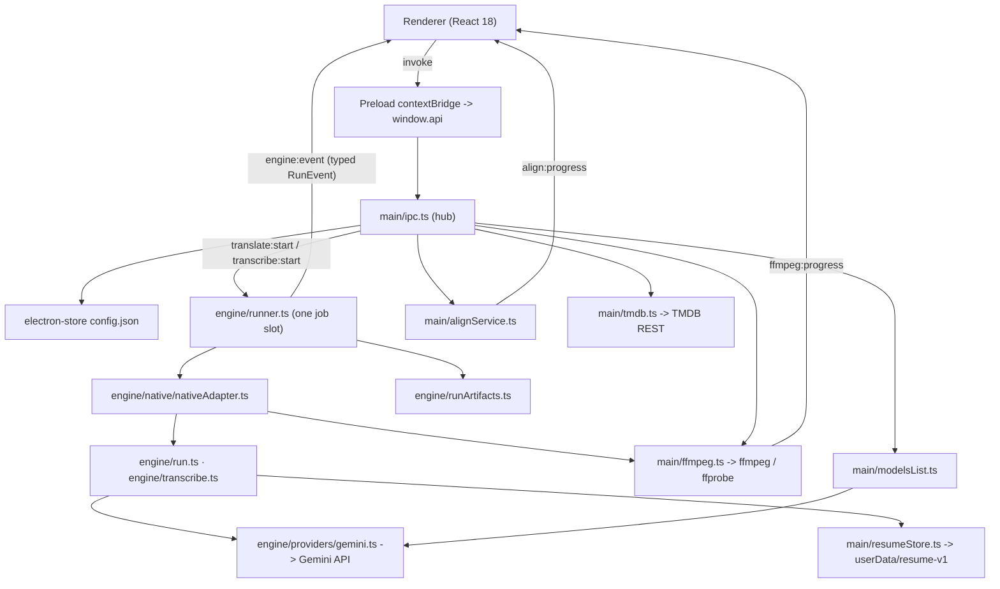

# Architecture

A map of how this app is put together, for anyone who wants to change it: the entry points, how a
run moves through the code, which module owns what, the files a run leaves behind, and the hazards
that have bitten before. For why each feature behaves as it does, and the tests behind those
decisions, see [`decisions/`](decisions/README.md).

## What it is

An Electron + React/TypeScript desktop app that translates and transcribes subtitles with Google's
Gemini models, and lines subtitles up against a reference.

**The engine runs inside the app.** Translation and transcription are TypeScript modules in the main
process that call the Gemini API through Google's SDK (`@google/genai`). Parts of the engine are
adapted from [gemini-srt-translator][gst] under its MIT licence (see `THIRD-PARTY-NOTICES.md`). No
engine executable or Python runtime ships or runs.

The app starts these other programs, and no others:

| Program | Started by | For |
|---|---|---|
| FFmpeg, FFprobe | `main/ffmpeg.ts`, `main/resumeStore.ts` (`-version`) | track probing and export, media duration, audio conversion and slicing for transcription |
| ALASS (Windows) | `engine/alassSidecar.ts` | Align → Advanced → Piecewise only |
| `reg.exe` (Windows) | `engine/providers/proxy.ts` | reading the per-user proxy setting, as the original engine did |
| `taskkill` (Windows) | `engine/runner.ts`, `main/processExit.ts` | ending a child process tree that outlives a stop |

Every one is started with an argument array and no shell; FFmpeg and FFprobe also get no stdin.

[gst]: https://github.com/MaKTaiL/gemini-srt-translator

## Layout

```
electron/
  main/       process entry, IPC hub, settings, model list, media, resume storage, Align service
  engine/     the native engine: runner, adapter, translation, transcription, provider, output,
              artifacts, redaction, RTL and wrong-alphabet repair, alignment
    native/   the adapter that turns a Start into a run
    providers/  the Gemini provider, its proxy rules and its response-size limit
  preload/    contextBridge -> window.api, plus its .d.ts contract
  shared/     types and contracts imported by BOTH processes
src/
  App.tsx  pages/  components/  lib/  store/  data/
scripts/
  gates/      the automated check suite
  verify/     probes against real FFmpeg, a real key or a real network seam
  check-bin.mjs, check-alass.mjs, electron-builder-*.cjs   release preflight and packer hooks
resources/bin/   ffmpeg, ffprobe, alass  (git-ignored; see "Getting the binaries")
licenses/, THIRD-PARTY-NOTICES.md   what ships and under which licence
```

### Every main-process file

| File | What it owns |
|---|---|
| `main/index.ts` | Process entry: the startup sweep, IPC registration, the window, and stopping a job on quit |
| `main/ipc.ts` | The IPC hub: every `window.api` call is handled here and routed to its owner |
| `main/store.ts` | The settings store, its defaults and the seed model list |
| `main/migrations.ts` | Versioned, non-destructive settings migrations |
| `main/modelsList.ts` | Model list curation, refresh, key checking and the Start-time model guard |
| `main/keyPreflight.ts` | Key-slot metadata and the result of the last key check |
| `main/ffmpeg.ts` | Locating FFmpeg/FFprobe, track probing and extraction, audio conversion |
| `main/translateSource.ts` | Reading a Translate source once, by its verified intake receipt |
| `main/resumeStore.ts` | The resume checkpoint on disk |
| `main/quotaBudgetStore.ts` | The Free-tier request journal on disk, written before every protected request |
| `main/tempFiles.ts` | The app's scratch folder `{userData}/temp` and its startup sweep |
| `main/exclusiveFile.ts` | Creating a file without ever replacing one that is already there |
| `main/processExit.ts` | Waiting until a child process has actually exited |
| `main/alignService.ts` | The Align tab's main-process owner |
| `main/textEditing.ts` | The native Cut / Copy / Paste menu on text fields |
| `main/tmdb.ts` | TMDB title and cast lookups |
| `main/opensubtitles.ts` | The OpenSubtitles protocol: Check, search and one selected download, with the shared-key and login rules |
| `main/checkedProxy.ts` | Loopback CONNECT relay for subtitle file downloads: resolves each host once and connects only to a checked public address from that answer |
| `main/osKeyPool.ts` | The shared OpenSubtitles key pool, refreshed at most daily, with its embedded fallback |
| `main/osService.ts` | The app's subtitle-source session (OpenSubtitles and Wizdom) and their IPC results |
| `main/wizdom.ts` | Wizdom search and archive fetch for the helper picker only; choosing among an archive's subtitles by alignment |
| `main/subtitleArchive.ts` | Downloaded subtitle bodies and archives, read in memory inside the fixed size and entry envelope |
| `main/referenceWalk.ts` | A run's gender reference: the chosen file aligned, or the serial OpenSubtitles walk with its frozen download cap and metadata-only log |
| `engine/runner.ts` | The one job slot, its artifact session, and everything that ends a run |
| `engine/adapter.ts` | The engine boundary: one run in, a typed event stream out |
| `engine/native/nativeAdapter.ts` | The native engine behind that boundary, for both run kinds |
| `engine/run.ts` | One translation run, from the source file to the saved subtitle |
| `engine/batching.ts` | Translation batches, the accepted map between them, and the run's request partitions |
| `engine/translationState.ts` | What a translation run has accepted |
| `engine/validateTranslationBatch.ts` | The check every translation reply passes before it is accepted |
| `engine/blocks.ts` | Classifying a provider's content blocks |
| `engine/prompt.ts` | The instruction and, for translation, the whole request |
| `engine/retry.ts` | Bounded failure for one logical request |
| `engine/keys.ts` | Which key slot a request uses and which one it moves to |
| `engine/requestBudget.ts` | When a Free-tier request may next be sent, from the journal and the known limits |
| `engine/requestAdvisor.ts` | Whether a translation batch fits the model's input limit, from exact token counts |
| `engine/transcribe.ts` | The transcription chunk loop |
| `engine/transcribeDedicated.ts` | The request and words of a dedicated transcription model |
| `engine/offsets.ts` | Timed words on the file's clock, merged by absolute offset |
| `engine/cues.ts` | Cues built from timed words by fixed subtitle rules |
| `engine/sourceLanguage.ts` | Detecting the spoken language from samples spread across the file |
| `engine/polish.ts` | Rewriting a finished transcript's wording, never its timing, and the check that each rewritten cue still matches its own |
| `engine/progress.ts` | The in-memory transcription record |
| `engine/coverage.ts` | What the loudness envelope says about a transcription answer |
| `engine/recover.ts` | Recovering refused or dropped audio by asking for less at a time |
| `engine/srt.ts` | SubRip, read and written |
| `engine/subtitleInput.ts` | Subtitle intake: the one owner of raw subtitle bytes |
| `engine/cueRepair.ts` | Reading a subtitle whose only problems are repairable |
| `engine/output.ts` | The run's subtitle on disk: the partial and the one same-folder replacement |
| `engine/runArtifacts.ts` | The run's artifact session: every log file it writes |
| `engine/redact.ts` | The one redaction pass every persisted artifact goes through |
| `engine/rtl.ts` | Right-to-left display copies |
| `engine/wrongAlphabet.ts` | The wrong-alphabet repair for Hebrew output |
| `engine/genderReaders.ts` | The designated Hebrew gender readers and which helper subtitles may hint |
| `engine/genderRepair.ts` | The guarded gender repair request and Method B's classifier |
| `engine/strayAlphabet.ts` | The other-alphabet redo request for Hebrew output (Thai, CJK and other scripts glued into Hebrew) |
| `engine/align.ts` | Global subtitle-to-subtitle timing alignment |
| `engine/alignmentResultStore.ts` | The Align tab's one live outcome |
| `engine/alignmentDiagnostic.ts` | The Align timing diagnostic file |
| `engine/alassSidecar.ts` / `engine/alassReport.ts` | Running ALASS, and decoding its JSON report |
| `engine/providers/gemini.ts` | Gemini through `@google/genai`; the only module that imports a provider SDK |
| `engine/providers/types.ts` | The provider contract |
| `engine/providers/proxy.ts` | Which proxy a request goes through and which certificates it trusts |
| `engine/providers/responseLimit.ts` | The HTTP transport the SDK sends through, with its response-size ceiling |
| `preload/index.ts` / `preload/index.d.ts` | `window.api` and its type contract |
| `shared/types.ts` | Settings, run arguments and IPC shapes |
| `shared/engineEvents.ts` | The run-event contract |
| `shared/consoleLog.ts` | The console log's and run record's names and bounds |
| `shared/runCopy.ts` | Sentences the run pages show |
| `shared/transcribeSettings.ts` | What a Transcribe run uses when the page overrides Settings |
| `shared/modelCaps.ts` | What a model id supports |
| `shared/keyOrder.ts` | Key-slot ranking |
| `shared/quotaGroups.ts` | Quota Groups: which keys share one Free-tier budget, and the edits to them |
| `shared/languages.ts` | Language names and codes |
| `shared/outputSanity.ts` | Detecting a translation the engine believed was fine |
| `shared/pricing.ts` / `shared/pricing.json` | The dated cost estimate and its vendored price table |
| `shared/ffmpegProgress.ts` | Reading FFmpeg's progress report |
| `shared/alignment.ts` | The alignment result contract |
| `shared/genderReference.ts` | The gender reference's run arguments, the Translate panel's draft and refusals, and the reference-language chain |

## Entry points

**Main process.** `electron/main/index.ts`, in order:

1. `app.whenReady()`
2. `sweepTempDir()` (`main/tempFiles.ts`) — removes week-old files from the app's own scratch folder,
   files only, before any window exists.
3. `alignService.resumeCleanup()` — removes Align scratch left by an earlier process.
4. `registerIpc()` — registers every channel. **Side effect:** importing `./ipc` transitively imports
   `./store`, which runs the settings migration chain at module load.
5. `createWindow()` — one `BrowserWindow`; external links go to the system browser through the same
   `https:`-only check as `shell:openExternal`.

On quit, `before-quit` vetoes once while `shutdownJob()` stops a running job (bounded, so a stuck job
delays the close rather than preventing it); `will-quit` disposes the Align service.

**Renderer.** `index.html` → `src/main.tsx` → `src/App.tsx`. There is no router: `App.tsx` holds the
tab (Translate, Transcribe, Align, Settings) in `useState`, and all four pages stay **mounted** with
visibility toggled by a class, so page state survives tab switches. The app opens on Translate.

`contextIsolation: true`, `nodeIntegration: false`. The renderer only ever sees `window.api`.

## Runtime topology



## Data lifecycle

### Settings

Stored by `electron-store` in `config.json` under the user-data directory. `getSettings()` returns
the whole object; `setSettings(patch)` merges key by key and returns the full object, which replaces
the renderer's mirror.

**Migrations run at `store.ts` module load, on every start**, but are version-gated by
`schemaVersion` (currently 5), so a migrated profile skips the chain entirely. The chain is
idempotent, *filters rather than resets*, bumps the version last, and writes a
`config.pre-migration-v<n>.json` backup before its first migrated write. It lives in `migrations.ts`
and imports no Electron API, so the check suite executes the real chain rather than a copy of it.

Two rules the chain must keep:

- **A migration may flag, but never replace, a user's model.** It runs offline at store load and
  cannot know what the API offers today.
- **Constants it reads must be right before it runs.** A later correction to a default cannot reach a
  profile that has already been migrated past that step.

A run reads Settings **once, at Start**. A change made while a run is in progress is the next run's.

A field can outlive its control. `disableStreaming` has no switch, because every request is already read
whole, but it stays in `AppSettings` and its default: stored profiles and the frozen settings of a paused
job carry it, and the resume decoder (`engine/progress.ts`) accepts only the exact key set it froze.
Removing a settings field is a migration, not a deletion.

### Model list

```
"Fetch Models & Check API Keys"
  -> checkApiKeys(keys)                              main/ipc.ts
     -> refreshModels(key) for EVERY non-empty key   main/modelsList.ts
        -> listGeminiModels                          providers/gemini.ts: the SDK's pager, every page,
                                                     models that support generateContent (RAW ids)
     -> summarizeRefresh(slots, activeSlots)
        -> unionIds (for display) + runnableIds (intersection over the ACTIVE set)
        -> outcome: allComplete | activeComplete | partial | failed
     -> buildModelList(unionIds, availability)       curation + provenance
  -> applyModelSelectionRules(stored, prevCached, next)
     -> three cases only: fresh install | proven absence | auto-advance
```

The listing is one bounded SDK call per page with a 60-second budget; it starts no process. Three
properties are load-bearing and easy to break by accident:

- **`refreshModels` returns raw ids, never a curated list.** Availability is decided from what the
  API said, not from what the picker chose to display.
- **A partial or failed refresh does not touch the cache.** Overwriting on a partial result drops
  models that only a currently-unreachable key can see.
- **A refresh may only be applied to the keys it asked about.** Verdicts, errors and
  `ModelInfo.availableOn` are addressed by *slot index*, while a full check can take up to a minute
  per key. The key fields are locked while one runs, and a result whose key snapshot has moved is
  discarded whole.

The evidence bar is deliberately asymmetric: an `allComplete` refresh is required to *delete* a
user's selection, while `activeComplete` is enough to advance a default nobody chose.

A key is only branded invalid when **the API refused it** (`classifyFetchFailure`); a DNS failure, a
timeout or an exhausted quota leaves it *unchecked* (`null`), and `keepProvenRejections` stops a check
that proved nothing from erasing an earlier rejection.

### A run, start to finish

Translate and Transcribe share one path:

1. The page builds `TranslateArgs` / `TranscribeArgs` and calls `startTranslate` / `startTranscribe`.
2. `main/ipc.ts` runs the outer guards (model availability, a usable key; for Translate, the source
   file's verified receipt through `main/translateSource.ts`) and calls `startRun()` with a fresh
   native adapter (`createNativeEngineAdapter`).
3. `engine/runner.ts` owns the **single job slot**. The adapter asks `reserveJob()` for it; a busy
   slot is refused before anything exists. On reservation the runner opens the run's artifact
   session and mints the run's one `started` event.
4. The adapter (`engine/native/nativeAdapter.ts`) takes the key snapshot, runs the key preflight,
   prepares media through FFmpeg where needed, and hands over to the engine: `engine/run.ts` for
   Translate, `engine/transcribe.ts` for Transcribe.
5. Every event the run says goes through the runner: recorded by the artifact session first, then
   delivered to the renderer over `engine:event`. The run ends with exactly one `finished`, which the
   artifact session enriches with the files it is offering before it is delivered.
6. The page reduces the typed stream (`src/lib/useRunner.ts`: `initialRunnerModel`,
   `reduceRunEvent`). Nothing in the renderer parses engine text.

Stop (`stopCurrent`) aborts the run's signal and any media preparation in flight; a reply that
arrives after Stop, or after the run's epoch has ended, is never committed.

### Translation

`engine/run.ts` takes one snapshot of the run's arguments and builds every request from it
(`engine/prompt.ts`). The subtitle is read by `engine/subtitleInput.ts`, the one owner of raw
subtitle bytes: BOM, strict UTF-8, then a closed set of legacy code pages, each scored for plausibility.
Batches are sent through `engine/retry.ts` and `engine/keys.ts` to the provider, checked by
`engine/validateTranslationBatch.ts` and committed by `engine/batching.ts`.

- **The count invariant.** A batch is committed only when it returns exactly the cues it was sent.
  A merge that nets against a split would otherwise ship misaligned text that looks clean.
- A reply that fails the check is sent again unchanged, after five seconds, on the run's one
  consecutive-error budget; the third bad reply in a row ends the run with the partial kept.
- After each commit, the whole subtitle so far is written to the partial (`engine/output.ts`): every
  source cue, translated where a batch has committed.

**Source intake, before Start.** When a subtitle is chosen, `subtitle:inspect` (`inspectSubtitleRequest`
in `main/ipc.ts`) reads it once: encoding, the language it reads as, and how certain that is. The
Translate page shows the result and asks when it cannot be sure (a short file, a legacy code page that
could be one of several languages, a Source Language that would misread the letters). The same request
runs the cue reader Start uses (`parseCues` in `engine/srt.ts`), so a file Start would refuse is refused
when it is chosen, with the same sentence: an ASS/SSA, WebVTT or TTML file, a file with no subtitle
timings, or text before the first cue. **Translation reads SubRip (`.srt`) only**; styled `.ass`
subtitles are not converted. Start then reads the file again through its verified receipt
(`main/translateSource.ts`), so a file that changed after it was inspected is not translated.
`engine/cueRepair.ts` accepts a file whose only problems are repairable, such as a cue whose end is
before its start.

**Context.** A run can carry a TMDB title (`main/tmdb.ts`: name or IMDb id, then its cast) and the
user's own Custom Context. Both go into the instruction (`engine/prompt.ts`); the console log records the
description through the redactor, never a configured secret. Settings' System Prompt Override is added
after the built-in instructions as its own section and removes none of them.

### Transcription

`engine/transcribe.ts` cuts the audio into fixed chunks (300 s by default), sends each once, offsets
its cues by the chunk's start and commits it before the next. Every answer is checked against the
audio's loudness envelope (`engine/coverage.ts`): too little text for the sound is refused, and a
refusal or loud audio left wordless is asked for again in smaller pieces (`engine/recover.ts`).
A reply that cannot be read at all is sent again at once, counted with the errors in a row, because a
chunk has no other recovery for it. Cues reach disk as each chunk commits. A completed transcript
with no cue at all raises a notice, and the Transcribe page ends in amber saying no words were found
instead of the green saved line.

A dedicated transcription model (an id containing `transcribe`) is not asked for timed JSON. Its
request (`engine/transcribeDedicated.ts`) carries the audio, `audioTranscriptionConfig.wordTimestamp`
and the one language the user confirmed, and nothing else. The model times every word itself.
`engine/offsets.ts` puts those words on the file's clock and merges pieces by absolute offset, so a
word said again just after a recovery's cut is kept as a second word, and words that start together
keep the order they were heard in. Text that arrives without its word timings is unreadable and is
sent again the same way. `engine/cues.ts` cuts them into cues by arithmetic, one chunk at a
time and never reaching back into the chunk before: 1–5 s, at most two lines of 42 characters, a
minimum duration, and a span the run could not transcribe left as an empty gap. A cue too short to
show is joined to a neighbour, or takes a moment from one, only where the rules still hold; one that
cannot be fixed keeps its words and is reported. When the user leaves polishing on, `engine/polish.ts` sends the
finished cue texts, and no times, 50 at a time and one request after another, to the polishing model
the Transcribe tab names, or to the translation model from Settings. Each returned text must still
match its own cue: one that is missing, empty, cut short, closer to a neighbouring cue, or that moved
words across a cue boundary is refused, and that cue keeps the transcription's own wording. A batch
with more than a fifth refused has lost its order and keeps all of its wording. A batch the model
refuses to edit for its content keeps its wording too, and the next batch is still sent; any other
request that fails for good stops polishing there, keeping what was already done. A batch that is
answered or refused ends a run of errors, so three in a row means three on one batch. A returned text
is laid out again by the same line rules, between characters for scripts written without spaces.
The log counts what changed and what was kept, and says why when nothing could be used. A polished
transcript is recorded as a revision of the finished one: same parts, same times, same cue counts,
only the text changes. Continue runs a dedicated record's own language and polish, never the page's,
so it asks no language question.

### The provider

`engine/providers/gemini.ts` is the only code that talks to Gemini. It builds the SDK request, reads
the reply whole (no streaming), classifies failures from structured fields rather than message text,
and lists models. `providers/proxy.ts` decides proxy and certificate trust exactly as the original
engine's libraries did; `providers/responseLimit.ts` is the HTTP transport the SDK sends through, and
enforces a ceiling on how much of a response body is read.
`engine/retry.ts` is the retry policy: quota waits, overload waits, key switching, and one ceiling of
three failures shared across every kind. Only a provider answer that calls the credential invalid
retires a key; no other failure cools, retires or rotates one.

### Free-tier protection

Every Gemini generation request passes one request gate (`createRequestGate` in `engine/run.ts`)
before it is sent. A token-count request does not pass it: Google does not charge counts against the
generation limits, so a count reserves nothing and never delays real work. The gate asks `engine/keys.ts` for a route over the run's ranked
keys, grouped into Quota Groups (`shared/quotaGroups.ts`: keys that share one Free-tier budget), and
asks `engine/requestBudget.ts` when the group may next send, from manual limits, limits the service
stated, and the request journal on disk (`main/quotaBudgetStore.ts`, written before each protected
request). A wait is shown as a typed `budget` event (`src/components/FreeTierNotice.tsx`); a group
that would have to wait hands over to another. Moving from a Free-tier key to a paid one needs Paid
fallback allowed in Settings, and happens only after Google refuses a Free key for quota or rate, says
the model is overloaded on a Free key, or when every Free group is spent for the day; a per-minute wait
is waited out. An overload moves that one request to the paid key at once instead of the 60-second
pause, and the next request tries the Free key first. Otherwise a daily limit
stops the run resumably. For Translate, `engine/requestAdvisor.ts` counts the exact
request against the model's official input limit; only a counted overflow halves the queued batches
(`engine/batching.ts` partitions), and no rate or quota failure ever shrinks a batch or an audio chunk.

### Output on disk

`engine/output.ts` owns the subtitle file:

1. Incremental writes go to `<name>.partial.srt` beside the destination; the destination does not
   exist until the run succeeds.
2. Every flush is atomic: a same-directory scratch file, fsync, then a rename over the partial.
3. Promotion is success-only: a final flush, then an atomic replace of the destination.
4. On failure or Stop the partial stays under its partial name and `finished.partialPath` names it.

### Resume (Continue / Start over)

`engine/progress.ts` defines the checkpoint; `main/resumeStore.ts` is its only reader and writer. The
root is `<userData>/resume-v1/`, one directory per generation (`job.json`, `checkpoint.json`, and
Translate's working output). A commit stages the new output, records the intent, lands it, and only
then records it as committed, so a crash leaves the old complete pair or the new one. `resume:inspect`
reads and decides but never writes; finishing or rolling back an interrupted commit happens only when
the user chooses Continue (`src/components/ResumeChoice.tsx`). Damaged generations are moved to
`resume-v1/quarantine/` with their bytes. None of it is under `userData/temp`, so the startup sweep
cannot reach it.

### The saved copy: RTL and the wrong-alphabet repair

A run's own output is canonical logical text. What the user saves is derived from it:

- **RTL display copies** (`engine/rtl.ts`, pure): five methods — Smart RTL, Hebrew Compatibility,
  Classic RTL, Basic-Player RTL, Old Subtitle Repair — each derived again from the canonical text, so
  a method is never applied to its own output. Cue count, numbers, timings and line order are kept.
- **Wrong-alphabet repair** (`engine/wrongAlphabet.ts`): for a Hebrew target, Arabic letters and
  Cyrillic, Greek or Armenian letters inside Hebrew words are repaired in the saved copy, and the
  console log says how many lines changed.
- **Other-alphabet redo** (`engine/strayAlphabet.ts`): this one changes the run's own output, not
  the saved copy. At the finishing step of a Hebrew run, any line holding a letter of another script (Thai,
  CJK, Devanagari, Hangul…, never the source's own script) goes to Gemini in one guarded request. Nothing is
  sent when no line qualifies, and a failure keeps every line.

Translate applies the recipe at Save (`saveSubtitleCopy` with `saveRecipeFor`, Settings as they
stand then and the run's target language). Transcribe applies RTL when it writes the destination, as
Settings stood at Start (`destinationCopy`); a transcript Align asked for stays canonical.

### Hebrew: the gender reference and the finishing steps

Hebrew marks gender on "you" and on verbs, and English does not, so a translation often guesses. A
Hebrew run can use a **gender reference**: a subtitle of the same release in a language that does mark
it. The Translate page's Gender Reference panel (`src/components/GenderReferencePanel.tsx`, frozen at
Start through `shared/genderReference.ts`) offers Off, **Choose a file**, or **Download automatically**.
A chosen file is aligned to the source first; a human Hebrew file can be marked as such. Download
automatically needs a TMDB title and runs `main/referenceWalk.ts`: one OpenSubtitles search, then
candidates one at a time in quality order until one aligns, inside a download cap frozen at the start
of the walk. Reference Strength is Hard or Hint.

At the end of the run, after the batches and before the output is promoted, `genderFinish`
(`engine/run.ts`) does the following, in order:

1. **Other-alphabet redo** (`engine/strayAlphabet.ts`), described above.
2. **Gender repair** (`engine/genderRepair.ts`). The designated readers (`engine/genderReaders.ts`)
   read each translated cue and its aligned reference line. Addressee gender is always read; speaker
   gender only with Settings' Advanced Hebrew Speaker switch; the Spanish and Portuguese source rules
   only with their own switches. The four Advanced Hebrew switches are shown, and used by a run, only
   while their master switch, Advanced Hebrew correction, is on; turning it off keeps their values. Cues whose readings disagree are sent in one guarded request (two when
   a speaker correction is involved). A reply is spliced only where every mechanical check holds. The
   cue count, order, numbers and times never change, an unflagged cue is never touched, and any failure
   keeps every cue as it was.
3. **Method B** (its own switch) asks once, without a reference, about the cues no reader could read,
   and repairs only what contradicts them. A cue where two people speak is skipped by both steps and
   counted in the log.

None of these steps returns or logs cue, reference, prompt or reply text; the log gets counts and closed
reasons. The switches can give different answers on two runs of the same film, and the tooltips say so.

### Subtitle sources and TMDB

`main/osService.ts` is the app's subtitle-source session. OpenSubtitles (`main/opensubtitles.ts`)
searches and downloads through the user's own key and login, or through a shared community key pool
(`main/osKeyPool.ts`, refreshed at most daily, with an embedded fallback). Its reported
`remaining_downloads` is read rather than guessed. Wizdom (`main/wizdom.ts`) is offered for the manual
helper picker only and is never part of the automatic walk. Downloaded bodies and archives are read in
memory inside a fixed size and entry envelope (`main/subtitleArchive.ts`), and file downloads go through
`main/checkedProxy.ts`, which connects only to a checked public address. The log is metadata only: no
subtitle text.

### The files a run leaves

`engine/runArtifacts.ts` is the one owner of a run's logs. It opens at reservation, records every
event before delivery, and closes everything before the terminal event, so whatever the page does
next is looking at complete files. Five projections, each with its own rules:

| File | When | What |
|---|---|---|
| `.console.log` | every reserved run | The run's safe summary (paths, model, settings, key count, the redacted description), every panel line once and in order, the token tally and the ending. 8 MiB head + 512 KiB tail, 64 KiB per line, `[log truncated]` marker. **Show it** links here (`findConsoleLog`) |
| `.run.jsonl` | every reserved run | One line per event: `{"schemaVersion":1,"sequence":N,"recordedAt":"<ISO UTC>","event":…}`, `started` first, the ending last. Each event passes a per-type field allow-list and redaction; strings clamped to 64 KiB including the truncation marker, lists bounded by the units the run admitted. A record that would outgrow 8.5 MiB stops there and is not offered, with one warning; the run carries on. No subtitle, prompt, request, response or description text, no thought summary, no Quota Group label |
| `.progress.log` | Translate, when enabled | A human-readable snapshot of progress and distinct diagnostics, replaced whole |
| `.thoughts.log` | Translate, when enabled | Model thought summaries under batch/attempt headings, replaced whole |
| `.tokens.json` | Translate and Transcribe, when enabled | The token report: gst's keys in gst's order, then a `native` section (requests, retries, waits, Quota Group switches, Paid fallback, daily stop, per-model and per-group buckets, Translate's request partitions, Transcribe's audio seconds). Translate writes it once work began; Transcribe once a request was sent, beside the chosen output. Its paths are retargeted to the user's files on Save |

All of them are named on the output's stem by full compound suffix and created exclusively — an
occupied name is stepped (`-2`), never overwritten (`main/exclusiveFile.ts`). Every string first
passes `engine/redact.ts`, which removes every configured secret. A writer that fails disables only
its own file and adds one `artifact` warning; the subtitle is never lost to a log. `finished.logPaths`
offers the reports, then the run record, then the console last.

Save (`dialog:saveFile`) copies each offered file beside the saved subtitle under its full suffix
(`sidecarDestination`; `path.extname()` would flatten `.run.jsonl` to `.jsonl`), and reports existing
canonical files it did not write as `stale` (`leftoverCanonicals`) rather than moving them.

### Media

`main/ffmpeg.ts` resolves FFmpeg and FFprobe in order: the path set in Settings → Advanced, the copy in
`resources/bin`, then PATH. It probes subtitle tracks, exports them (`-c:s srt` or `-c:s copy`),
measures duration (`probeDuration`, which forwards the caller's `AbortSignal`), and converts audio.
Progress goes over its own channel, `ffmpeg:progress`, never the run's log. `readProgressChunk` and
`percentOf` (`shared/ffmpegProgress.ts`) report what FFmpeg said or nothing, and cap at 99% while the
process is alive.

### Align

`main/alignService.ts` owns the Align tab. Main decides the profile, the verdict, the bytes and the
destination; the renderer names inputs and a generation. A newer analysis cancels the older one;
nothing is written until Apply, which opens the Save dialog, re-checks the source digest and replaces
the destination atomically. Only timing lines change. Advanced → Piecewise runs ALASS through
`engine/alassSidecar.ts`, judged by `engine/alassReport.ts`; when ALASS is missing or damaged, only
that mode is unavailable.

## IPC surface

Request/response channels registered in `main/ipc.ts`, exposed through the preload bridge and typed
in `electron/preload/index.d.ts`.

| `window.api` | Channel | Notes |
|---|---|---|
| `getSettings` / `setSettings` | `settings:get` / `settings:set` | full object in and out |
| `getCachedModels` | `models:getCached` | re-curates, preserving stored provenance |
| `refreshModels` | `models:refresh` | one key |
| `checkApiKeys` | `models:checkKeys` | every key; the path Settings uses |
| `openFile` / `openFolder` / `saveFile` | `dialog:*` | `saveFile` writes the subtitle copy and its sidecars; a failed subtitle copy returns `error` and an empty `path`, a failed sidecar returns `path` plus `error` |
| `showItemInFolder` / `openExternal` | `shell:*` | `openExternal` allows `https:` only |
| `probeTracks` / `extractTrack` / `extractToTemp` | `video:*` | FFprobe / FFmpeg |
| `tmdbSearch` / `tmdbCast` | `tmdb:*` | |
| `inspectSubtitle` | `subtitle:inspect` | reads a subtitle once: encoding, language, receipt; refuses a file Start's cue reader would refuse |
| `alignAnalyze` / `alignCancel` / `alignPreview` / `alignApply` / `alignAdvancedStatus` / `alignExportDiagnostic` / `alignOpenDiagnostic` | `align:*` | |
| `inspectResume` | `resume:inspect` | read-only |
| `startTranslate` / `startTranscribe` | `translate:start` / `transcribe:start` | return the output path |
| `stop` / `isRunning` | `translate:stop` / `translate:isRunning` | shared by both kinds |

Push events: `engine:event` (the typed `RunEvent` stream, both kinds, addressed by `runId`),
`ffmpeg:progress`, `align:progress`.

## What ripples when you change it

| Module | Why a change ripples |
|---|---|
| `electron/shared/types.ts` | One contract spanning main, preload and renderer. An `AppSettings` field also touches the store defaults and the migration chain |
| `electron/shared/engineEvents.ts` | The run stream's contract: the runner, the adapter, the artifact session, the run record's allow-list (`RUN_RECORD_EVENT_SHAPES`) and the renderer's reducer all follow it |
| `main/ipc.ts` | The hub; every user action routes through it |
| `engine/runner.ts` | The one job slot and the one artifact session per run |
| `engine/runArtifacts.ts` | Every log file's contract |
| `src/components/ui.tsx` | Primitives used by every page |
| `electron/shared/languages.ts` | Drives UI labels, request languages and subtitle-track matching |
| `electron/shared/modelCaps.ts` | The only place deciding thinking mode, budget range, transcription support and whether a model still honours temperature/top-p/top-k. Unknown ids are later releases and resolve to "does not accept" |
| `electron/shared/keyOrder.ts` | The single key ranking for runs, badges and tier display (`orderKeySlots`), and slot-evidence bookkeeping (`forgetSlotEvidence`, `reindexEvidenceAfterRemoval`) |
| `electron/main/migrations.ts` | Owns every write to a legacy profile. Pure and Electron-free |

Notable helpers, and the promise each makes:

| Helper | Promise |
|---|---|
| `buildModelList()` | Runs on read **and** write, and is idempotent. Sorts by version tuple, marks previews, records provenance |
| `compareVersions()` | Tuple comparison. Never `parseFloat` — see hazards |
| `summarizeRefresh()` | The single place refresh completeness is judged |
| `guardModelForSpawn()` | Blocks a Start only on positive evidence a model is absent; warns when availability is unknown |
| `applyModelSelectionRules()` | The only code allowed to change a stored model, in three cases and no others |
| `shouldPersistSamplingToggleOff()` | The single rule for switching Custom Generation Parameters off on the user's behalf; `selectionSettingsPatch()` is its main-process caller |
| `companionName()` / `extractedTrackName()` (`src/lib/outputName.ts`) | The single definition of what a written file is called |
| `createRedactor()` (`engine/redact.ts`) | Removes every configured secret from anything persisted or shown |
| `estimateCost()` (`shared/pricing.ts`) | Exact model and tier from the vendored price table, or nothing; never a guessed tier |

### Three contracts that cross the process boundary

| Contract | Shape | Persisted? |
|---|---|---|
| `modelNeedsVerification` | `boolean` on settings, set when a stored model id looks suspicious but is unproven | **Yes.** Advisory only; it never authorises a reset |
| `refreshOutcome` | `allComplete` / `activeComplete` / `partial` / `failed` | **No.** It describes one fetch attempt |
| The **active set** | The ranked key slots truncated to two. Its size comes from the ranked list, not from how many slots are configured: one valid key plus two dead reserves gives an active set of one | Derived, never stored |

## Reading the code comments

Many comments end with a short label: a decision number such as `D3`, a finding id such as `SOL-55`,
the name of a work package or a section of a planning document, or a line in an older release such as
`0.2.533 translate.py:4359`. These point into the maintainer's planning and evidence records, which are
kept privately and are not part of this repository. A label lets the maintainer find the decision, the
measurement or the defect behind a rule. It is not a link you are expected to follow. **The code and
the check suite are the authority for what the app does**, and every rule that matters has a gate in
`scripts/gates/gates.ts` that names it in plain words. When a comment and the code disagree, the code
is right and the comment is the bug.

**Why a rule is the way it is.** [`decisions/`](decisions/README.md) holds one public record per
feature: what was tested, how many times, the results and their analysis, and why each behaviour is
on, off or rejected. Each record ends with a label index, so a label found in a comment can often be
looked up there. Those records explain decisions; they do not override the code.

## Hazards

1. **One job at a time**, enforced in the main process by the runner's slot. The UI has no separate
   guard.
2. **`resources/bin/` is git-ignored.** A fresh clone has no binaries; see below.
3. **Never `parseFloat` a model version.** `parseFloat('3.10') === 3.1`, so a two-digit minor sorts
   below `3.9` and "newest" silently picks the older model.
4. **A migration cannot prove a model is gone**; only a complete refresh can.
5. **`handleNew` goes through `clearVideo()` and must not clear `ffmpeg`.** `setVideoFile('')` lets an
   in-flight probe refill tracks.
6. **Alignment is a separate sanity axis** (best-window Pearson r). Do not fold it into the
   filler signals, and do not Save a failed Translate run.
7. **Identify a sidecar by its full suffix**, never `path.extname()`. Adding a log type means adding
   its suffix to `KNOWN_SIDECAR_SUFFIXES` in `main/ipc.ts`.
8. **A log never costs the subtitle.** Every artifact writer fails soft; a change that lets a log
   failure end a run or skip a promotion is a data-loss regression.

## Building and checking

| Command | Does |
|---|---|
| `npm run dev` | electron-vite development server |
| `npm run typecheck` | `tsc --noEmit` over the node, web and scripts projects |
| `npm run test:gates` | The check suite. No API key. Prints its own assertion total and refuses to pass below its floor |
| `npm run build` | Builds main, preload and renderer into `out/` |
| `npm run check:bin` | Release preflight: FFmpeg and FFprobe present at the exact names the packaged app resolves, regular files, non-empty |
| `npm run build:win` | Preflight for Windows, build, then the portable Windows zip |
| `npm run build:dir` | Preflight, build, then an unpacked app |

`test:gates` bundles the **real** main-process modules with esbuild and stubs only `electron` and
`electron-store`, so a check cannot pass against a stale copy of the logic.

Packaging is guarded inside the packer, not only by npm script order. `scripts/electron-builder-*.cjs`
are thin wrappers over `electron-builder-verify.cjs`:

- **beforePack** runs `check-bin.mjs` on the source tree, and on Windows `check-alass.mjs --package`.
- **afterPack** runs `check-bin.mjs` against the copied binaries in the unpacked app, and checks the
  ALASS unit file by file against `licenses/alass/2.0.0/UNIT-MANIFEST.json`.
- **afterAllArtifactBuild** inspects the ZIP/AppImage that actually ships: exactly one non-empty
  FFmpeg and FFprobe at the runtime path of that platform, and no engine executable, Python runtime,
  compiled Python or Python package payload; on Windows the ALASS unit again, as extracted.

`check-bin.mjs` takes the required names from `--target`, so cross-building for Windows from another
OS still demands `.exe`.

`scripts/verify/` holds probes, each with its own `run-*.mjs` entry point, for claims the gates
cannot settle with stand-ins:

| Probe | Needs a key? | Settles |
|---|---|---|
| `run-badkey.mjs` | **No** | That a rejected key ends the run and is reported as a check that did not happen |
| `run-consolelog.mjs` | No | That real runs through the real runner leave a real console log and run record, complete and closed, from completed, failed, stopped and refused runs |
| `run-buffering.mjs` | No | That a run's preparation reaches the page as it happens, through the bundled FFmpeg |
| `run-fetch-timeout.mjs` | No | That a model listing to a server that never answers is abandoned at the real 60-second budget, without blaming the key |
| `run-progress.mjs` | No | That a real FFmpeg streams progress and its numbers climb, and that the progress flags do not change the file produced |
| `run-sanity-corpus.mjs` | No | Calibrates the output-sanity thresholds against real subtitles; skips without a corpus |
| `run-thinking.mjs` | **Yes** | That thinking settings reach the request and behave per model |
| `run.mjs` (`verify:live`) | **Yes** | Live native Translate and Transcribe, model choice and media extraction |

The keyed probes read `.secrets/gemini-key.txt` (or `GEMINI_API_KEY`), never print it, and spend
quota. A few checks need sample media in `.secrets/fixtures/` and report SKIP without it.

### Getting the binaries

`resources/bin/` is git-ignored, so a clean clone cannot package until you put these there:

- `ffmpeg` and `ffprobe` (`.exe` on Windows) — from any standard build. Check your binary's licence
  with `ffmpeg -version` (see `THIRD-PARTY-NOTICES.md`); the app needs no GPL-only component.
- `alass/2.0.0/alass.exe` (Windows) — built from `vendor/alass/2.0.0` by `scripts/build-alass.ps1`,
  which reproduces the recorded executable byte for byte.
