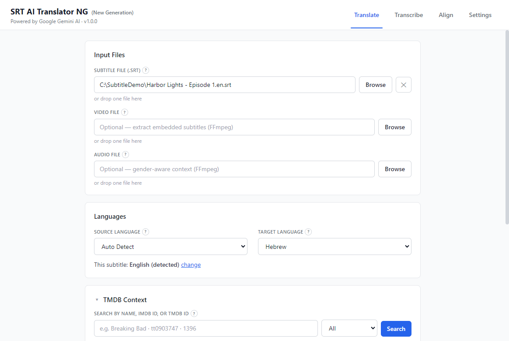
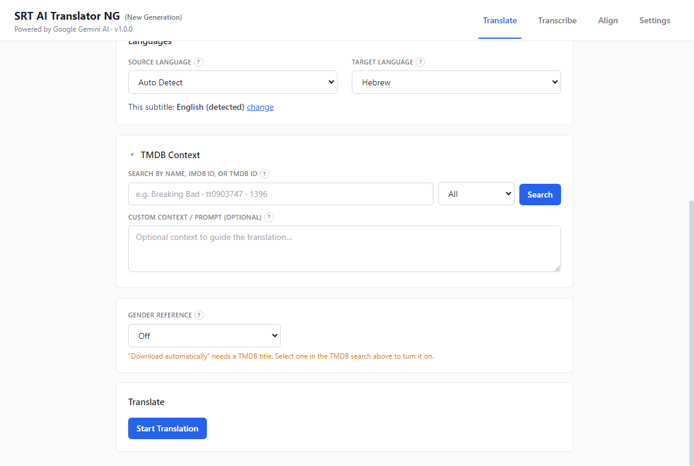
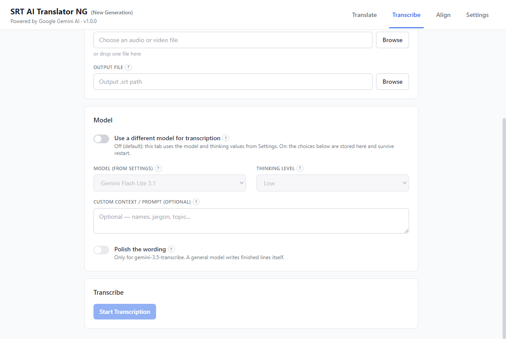
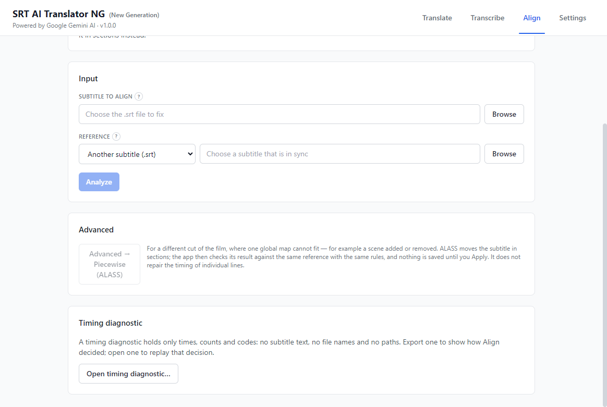
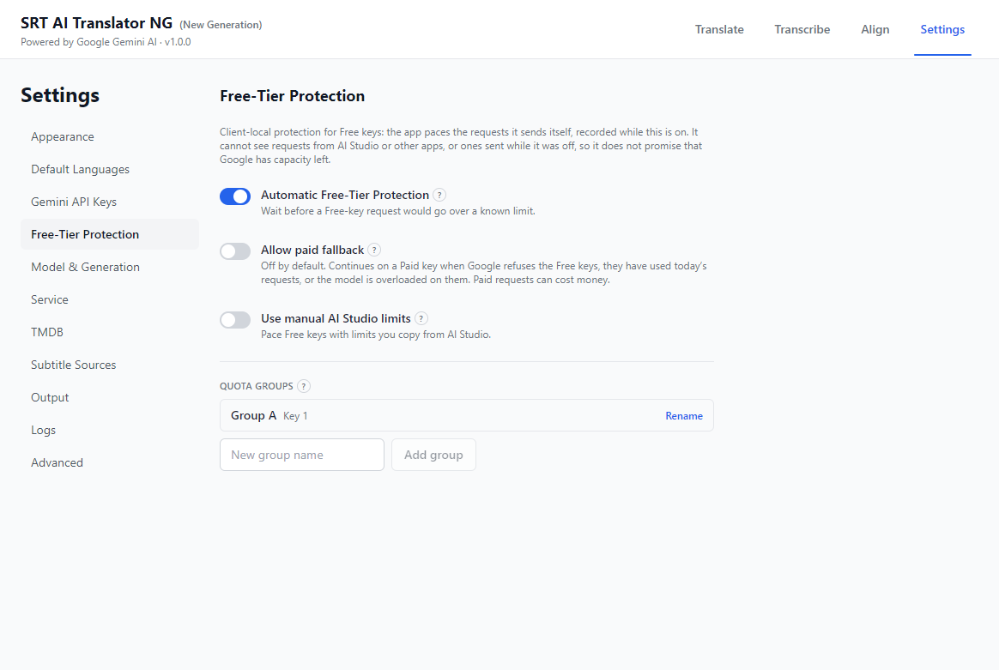
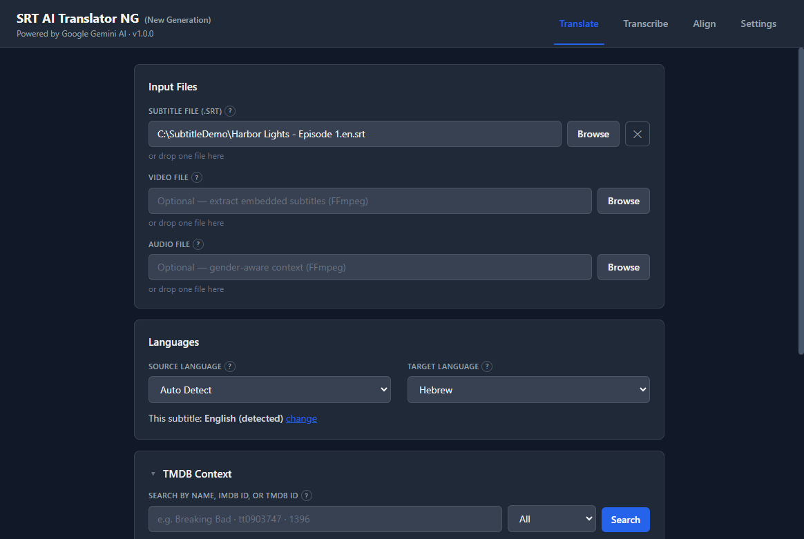
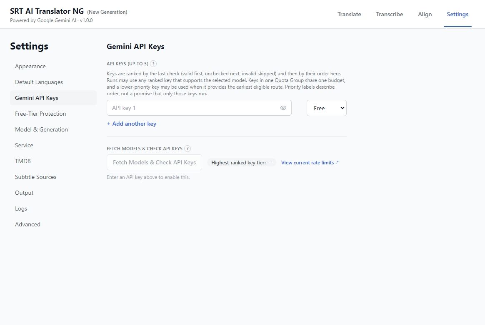
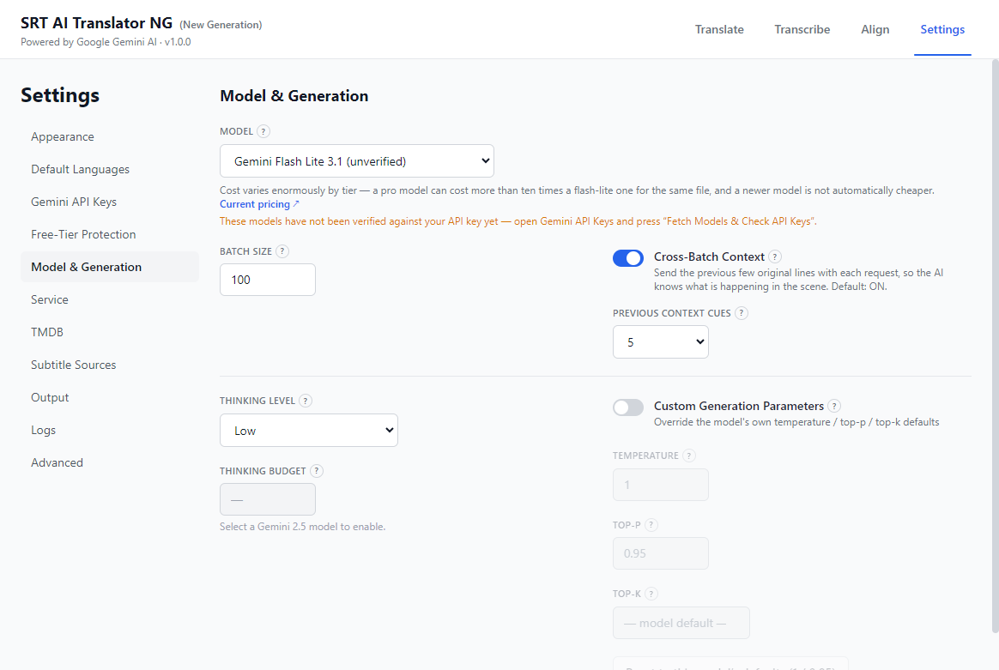
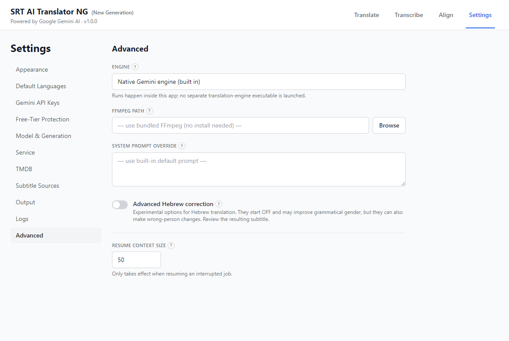

# SRT AI Translator NG (New Generation)

A portable Windows desktop app for **translating, transcribing and aligning subtitles** with Google
Gemini. You bring your own Gemini API key; the app does the rest: batching, retries, quota pacing,
checking what comes back, and saving a subtitle your player can show.



**NG is a new generation of [SRT AI Translator](https://github.com/Akila3/SRT-AI-Translator).** The
engine was rewritten from scratch inside the app: it calls the Gemini API directly instead of driving
a command-line program, which is what makes most of the features below possible. The two are
separate products, so they can be installed and run side by side.

## Contents

- [What it does](#what-it-does)
- [Install](#install)
- [How to use it](#how-to-use-it)
- [Settings](#settings)
- [Files a run leaves](#files-a-run-leaves)
- [Privacy and keys](#privacy-and-keys)
- [Development](#development)
- [License](#license)

## What it does

**Translate**
- Translate a SubRip `.srt` subtitle into another language. The encoding (UTF-8, or a legacy code page
  such as Windows-1255) and the source language are detected when you choose the file, and the app
  asks when it cannot be sure instead of guessing.
- Pick a subtitle track straight from a video file. Text tracks can also be exported as `.srt`, and
  image (PGS) tracks as `.sup`. If the video already has a track in your target language, the app says
  so before you spend quota.
- Add context: search **TMDB** for the film or series (title, IMDb id or TMDB id) and its cast, and add
  your own notes for the model.
- Every batch must come back with exactly the lines it was sent. A reply that merges or splits lines is
  rejected, so the saved subtitle never drifts out of step with the original.
- If a run fails or you stop it, what was finished is kept, and the run can be **continued** later
  rather than started over.

**Hebrew and right-to-left languages**
- A **gender reference**: Hebrew marks gender on "you" and on verbs where English does not. The app can
  use a subtitle of the same release in a language that does mark it, either a file you choose or one
  it downloads from OpenSubtitles, to correct the translation's guesses.
- Optional **Advanced Hebrew correction** (experimental, off by default): speaker-gender repair, a
  repair pass for lines no reference covered, and Spanish/Portuguese reference rules.
- Clean-up passes on Hebrew output: lines containing letters from the wrong alphabet are repaired or
  sent back for a redo.
- Five **RTL display methods** for saved copies (Smart RTL, Hebrew Compatibility, Classic RTL,
  Basic-Player RTL, Old Subtitle Repair), so the subtitle displays correctly on players that handle
  right-to-left text differently.



**Transcribe**
- Turn the speech in an audio or video file into a new timed `.srt`, in the language spoken.
- Long files are sent in chunks. Each answer is checked against how much speech the audio actually
  contains, and a chunk that comes back too empty is asked for again in smaller pieces.
- Supports Gemini's dedicated transcription models (word-level timings, cues built by fixed rules) and
  an optional polishing pass that tidies the wording without moving any timing.



**Align**
- Fix a subtitle that runs early, late or drifts, using a reference with the right timing: another
  subtitle of the same release, or the video itself.
- Finds one global correction (a shift, plus a speed change such as 23.976 to 25 fps) and offers it only
  when the evidence supports it. **Advanced → Piecewise** (ALASS) can align a different cut of the film
  section by section.
- Only the times change, and nothing is written until you choose where to save.



**Keys and quota**
- Up to five Gemini API keys, ranked by their last check. Mark each one Free or Paid yourself; Google
  does not report a key's billing tier.
- **Free-Tier Protection** paces Free-key requests so a run waits instead of hitting a limit. Keys from
  one Google Cloud project can be grouped so they share one budget. A run moves to a Paid key only if
  you allow it.
- The model list comes from what your own keys can actually use, not from a fixed list.



**And also**
- Light, dark and automatic themes.
- A log beside every output, written as the run happens, so a failed run can still be diagnosed. API
  keys never appear in it.



## Install

### Requirements

- Windows 10 or 11, 64-bit.
- A Google Gemini API key. Get one free at <https://aistudio.google.com/apikey>.

Nothing else: no Python, Node.js or FFmpeg install. FFmpeg, FFprobe and ALASS ship inside the app.

### Portable release

1. Download `SRT.AI.Translator.NG-<version>-portable.zip` from the
   [latest release](https://github.com/Akila3/SRT-AI-Translator-NG/releases/latest). GitHub shows the
   spaces in the file name as dots; it is the same file as `SRT AI Translator NG-<version>-portable.zip`.
2. Extract the ZIP anywhere: your Desktop, another folder, or a USB drive.
3. Run `SRT AI Translator NG.exe` from the extracted folder.
4. Open **Settings → Gemini API Keys**, paste your key and press **Fetch Models & Check API Keys**.

Settings and keys are stored per Windows user in `%APPDATA%\srt-ai-translation-ui-ng`, not in the
extracted folder, so you can replace the folder with a newer version and keep your settings.

### Coming from SRT AI Translator 1.1.0

NG has its own settings, so 1.1.0 keeps working untouched and nothing is imported: add your keys once
in NG. NG translates `.srt` only; for styled `.ass` subtitles keep using 1.1.0.

## How to use it

### Translate a subtitle

1. Open **Translate** and choose the `.srt` file (Browse, or drop it on the field). The app shows the
   language it detected underneath; use **change** if it is wrong.
2. Choose the **Target Language**.
3. Optional: choose a **video file** to pick one of its embedded subtitle tracks instead, or an
   **audio file** so Gemini can hear who is speaking (helps gendered languages such as Hebrew, Spanish
   and French).
4. Optional: search **TMDB Context** for the title, and add your own notes in **Custom Context**.
5. For Hebrew, choose a **Gender Reference**: Off, a file of your own, or Download automatically (needs
   a TMDB title).
6. Press **Start Translation**. Progress, waits and warnings appear as they happen.
7. When it finishes, **Save** the translated subtitle. The log files are copied beside it.

If a run was interrupted, pressing **Start Translation** on the same file again offers **Continue** or
**Start over**.

### Transcribe audio or video

1. Open **Transcribe** and choose an audio or video file. The output `.srt` defaults to the same folder
   and name.
2. Optionally choose a different model for transcription.
3. Start. With one of Gemini's dedicated transcription models, the app first detects the spoken
   language and asks you to confirm it; other models need no language. Cues are saved chunk by chunk,
   and a stopped run keeps what it finished. Continuing a stopped run reuses its saved model and
   language.

### Align a subtitle

1. Open **Align**, choose the subtitle whose timing is wrong, and choose the reference: another subtitle
   or the video.
2. Press **Analyze**. The app shows the correction it found and the evidence for it: what was compared
   and how much of it agreed.
3. Press **Apply** and choose where to save the aligned copy. The original file is never changed.

## Settings



| Section | What is there |
|---|---|
| **Appearance** | Theme: Light, Dark or Auto |
| **Default Languages** | Source and target language the Translate page starts with |
| **Gemini API Keys** | Up to five keys, each marked Free or Paid; **Fetch Models & Check API Keys** checks every key and rebuilds the model list |
| **Free-Tier Protection** | Automatic pacing for Free keys, Allow paid fallback, manual AI Studio limits, safety reserve, and Quota Groups |
| **Model & Generation** | Model, batch size, cross-batch context, thinking level or budget (whichever the model supports), and optional custom temperature / Top-P / Top-K |
| **Service** | Gemini service tier |
| **TMDB** | Your own TMDB key, if you want your own quota (a built-in one is used otherwise) |
| **Subtitle Sources** | Your OpenSubtitles account and API key, used for gender-reference downloads. Without them a shared community key pool is used |
| **Output** | Default output folder, and right-to-left formatting with its display method |
| **Logs** | Token usage display and report, progress log and thoughts log |
| **Advanced** | FFmpeg path override, System Prompt Override (added after the built-in instructions, never replacing them), Advanced Hebrew correction, resume context size |





## Files a run leaves

Beside the saved subtitle, under the same name:

| File | When |
|---|---|
| `.console.log` | Always. What the run reported, in order. Attach it when reporting a problem |
| `.run.jsonl` | Always. A step-by-step record of settings, progress, warnings and the ending, with no subtitle text |
| `.tokens.json` | When Write Token Report is on |
| `.progress.log` | Translate, when Progress Log is on |
| `.thoughts.log` | Translate, when Thoughts Log is on |

The console log and the run record are size-bounded so a very long run cannot fill the disk. The console
log keeps its first 8 MiB and last 512 KiB, with long lines shortened, and marks where it was cut. A run
record that reaches its size limit stops there and is not offered, and the run says so in a warning. If a
log cannot be written, the run carries on, warns, and the subtitle is still saved.

While a translation runs, the work in progress is `<name>.partial.srt`. The real file appears only when
the run succeeds, so a failed run never leaves a half-translated file under the final name.

## Privacy and keys

- Subtitle text and audio go only to the Google Gemini API, under your own key and Google's terms.
  TMDB and the subtitle sources receive only searches (a title or an id), never your subtitle.
- API keys are stored in your Windows user profile and are removed from every log, record and error
  message the app writes.
- Reference subtitles are downloaded from OpenSubtitles or Wizdom only when you ask for one.

## Development

Read [ARCHITECTURE.md](ARCHITECTURE.md) first. It covers how the pieces fit, which modules affect each
other, the contracts between processes, and the hazards that have caused real bugs here.

### Requirements

- Node.js. The project is developed and checked on Node 24.
- Windows, to build the Windows release (ALASS is Windows-only).

```bash
npm install
npm run dev
```

### Checks

```bash
npm run typecheck   # the node, renderer and scripts projects
npm run test:gates  # the check suite: no API key, prints its own assertion total
npm run check:bin   # release preflight: the bundled binaries are present
```

`test:gates` bundles the real main-process modules with esbuild and stubs only `electron` and
`electron-store`, so a check cannot pass against a stale copy of the logic. It refuses to pass if its
assertion count falls below the recorded floor.

`scripts/verify/` holds optional probes that use real FFmpeg, a real network seam or a real key. Most
need no key; the keyed ones read `.secrets/gemini-key.txt` (or `GEMINI_API_KEY`), never print it, and
spend quota.

### Building

`resources/bin/` is not tracked, so put these there first:

- `ffmpeg.exe` and `ffprobe.exe`, from any standard build.
- `alass/2.0.0/alass.exe`, built from `vendor/alass/2.0.0` by `scripts/build-alass.ps1`, which
  reproduces the recorded executable byte for byte. It needs the exact toolchain named in
  `vendor/alass/2.0.0/build-receipt.json` (rustup's `stable-x86_64-pc-windows-gnu` at that rustc/cargo
  version, and that MinGW-w64 `gcc` on `PATH`) and refuses to build with any other; see
  [vendor/alass/2.0.0/README.md](vendor/alass/2.0.0/README.md).

```bash
npm run build:win
```

The output is `release/SRT AI Translator NG-<version>-portable.zip`. The packer checks the binaries
before and after packing, and inspects the finished ZIP.

### Project layout

```text
electron/
  main/       process entry, IPC, settings, model list, media, resume storage, Align
  engine/     the translation and transcription engine, the Gemini provider, output, logs, RTL, alignment
  preload/    the typed bridge the renderer uses (window.api)
  shared/     types and rules used by both processes
src/          the React interface: pages, components, state
scripts/
  gates/      the check suite
  verify/     optional probes against real FFmpeg, network or key
vendor/alass/ ALASS source, for the bundled executable
licenses/     third-party licences shipped with the app
assets/       README screenshots
```

### Repository safety

Ignored by Git: `node_modules/`, `out/`, `release/`, `resources/bin/`, `.secrets/`, logs and build
caches. Never commit an API key, a `.env` file, local app settings, generated translations or private
subtitle and media files. A key that was pushed once must be treated as burned even after it is
removed, because Git history is permanent.

## License

Released under the [MIT License](LICENSE).

The portable build also redistributes software owned by others, which stays under its own licence:

| Component | Used for | Licence |
|---|---|---|
| [FFmpeg](https://ffmpeg.org/) and FFprobe | track export, audio conversion | GPL v3 for the bundled build (LGPL builds also work); its source is a separate download on the [release page](https://github.com/Akila3/SRT-AI-Translator-NG/releases/tag/v1.0.0) |
| [ALASS](https://github.com/kaegi/alass) 2.0.0, modified | Align → Advanced → Piecewise | GPL v3 or later; full source ships beside it |
| [Google Gen AI SDK](https://github.com/googleapis/js-genai) and its dependencies | talking to Gemini | Apache-2.0, BSD-3-Clause, MIT |
| [Electron](https://www.electronjs.org/) | the application shell | MIT, with Chromium's notices |

Parts of the engine are adapted from
[gemini-srt-translator](https://github.com/MaKTaiL/gemini-srt-translator) (MIT, Copyright (c) 2024
Matheus Castro), and several features from the Kodi add-on
[service.subtitles.kodipovilai](https://morantheking.github.io/Kodi-POV-IL/) (MIT, Copyright (c) 2026
MoranTheKing). FFmpeg and ALASS run as separate programs; none of their code is linked into this
application.

[THIRD-PARTY-NOTICES.md](THIRD-PARTY-NOTICES.md) has the full licence texts, the source locations and
what each licence requires.

This product uses the TMDB API but is not endorsed or certified by TMDB. It is not affiliated with or
endorsed by Google, OpenSubtitles or Wizdom.
